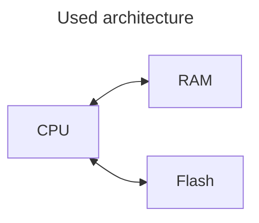
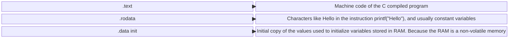
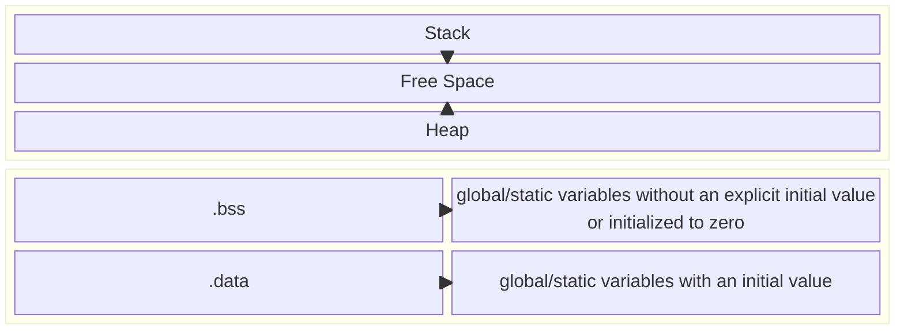

# Statement

Implement a "hello world" program. Once you have the basic version working, add functionality to read a name from the command line arguments. In addition, explain the running process flow for this program. This means what happens from power-on until the program execution begins, how the different components are initialized, and how the code is stored in memory.

#### Computer ejecutable flow in C
This question is asking how a program works during runtime. The purpose is to evaluate if we know the execution flow of a program and the component initialization process in a low-level device, like a microcontroller. This question is answered using the simplest model of a computer, just CPU, RAM and Flash. 

So for this case, let's define RAM and Flash memory usage and its characteristics:

*Flash*: Flash memory is non-volatile memory, which means that the data is not erased when the memory is out of power. It's a memory uses SSD as technology. Because it can store bits efficiently, the cost per bit is low. But bits feching and storing is slower than other memories, that's why flash memory is lower in the hierachy (means that is farther from the CPU). It usually stores data:
- The code
- Constants
- Initial data

*RAM*: A RAM is a volative memory, which menas that the data is erase when the memory is out of power. It's more expensive, but it's faster, and for this reason is used nearer of the cpu. The storage capacity is lower as well. It usually storage:
- Variables
- Stack
- Heap
- Buffers

##### Initialization of the components
Imagine that just the cpu and their  is reset. After this the different components like interrupts, perhipericasls, stack, etc. need a especific bytes in their registers to configure evrething. For that reason as the flash is a non volatile memory there is a code that is ejecuted automaticly to set up this components, thats the initialization. 

##### Running time flow 
As we already define the architecture structure, we can start explaining how te running time works. First, the code is stored .text block memory in Flash memory, then some data as constants, strings and a copy of the initial values are stored in the memory blocks of .initial data and .rodata. 

Then in the RAM for this case as we do not have a allocated memory we can ignore the heap memory. Then as the main function is called the main function block is stored in the stack. and the first instruction "printf" is ejecuted and read the .rodata block memory where the string is stored. Then the for loop is ejecuted, the i variable is stored in the stack and then deleted as it's a local variable. The print inside basically read the direction were the argv array is stored, it depends maybe a register inside the CPU or the stack. 

To finish the las print is ejecuted and it works exactle as the other ones. 

